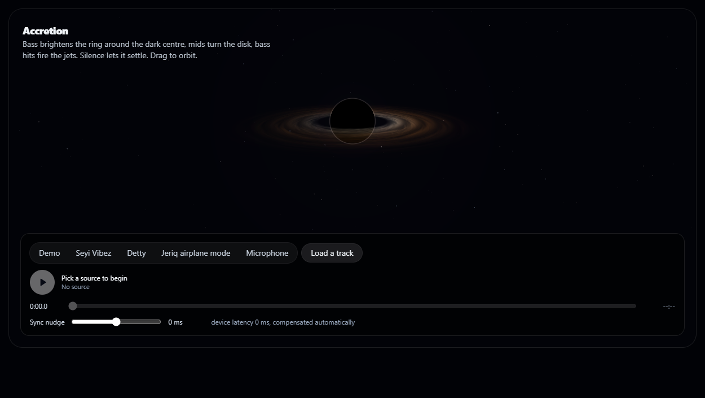
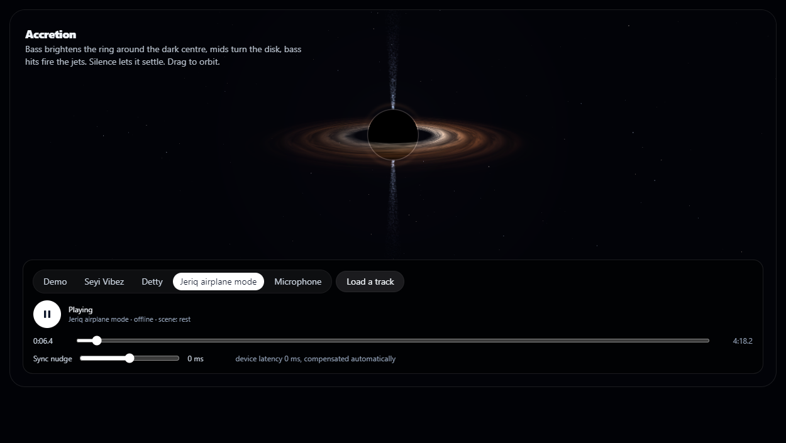
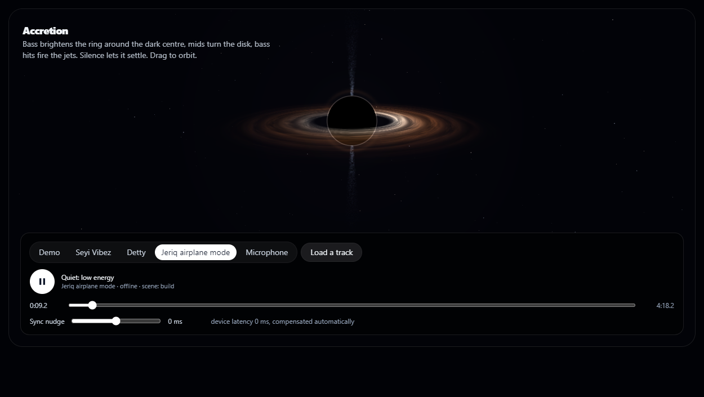
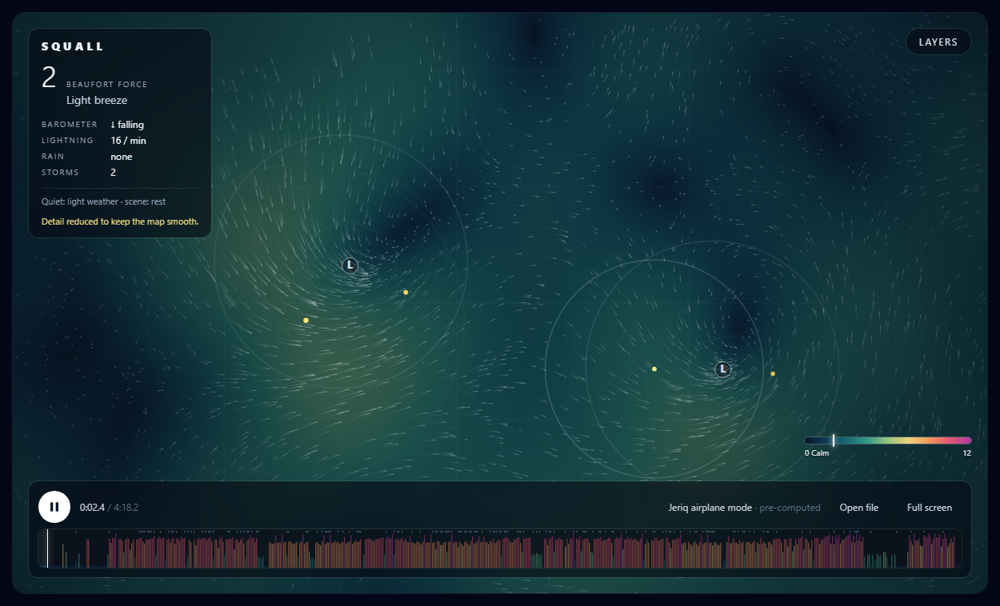

# Accretion: a black hole that listens

The second main visual of AudioLab, after [Squall](../../web_kit/DESIGN.md) (the weather map). A black hole
seen from the side, built with Three.js and a custom shader. A song feeds the same audio features Squall
reads, and the black hole answers them.

The code lives in `web_kit/`. This folder holds the design notes and screenshots.

## Screenshots

Captured from a real run on an Intel UHD GPU (headless Edge), playing the exported "Jeriq airplane mode" song.

| | |
|---|---|
|  | **Resting.** No source is playing. The disk is dim and slow, and the jets are off. |
|  | **Playing.** The disk turns and brightens, and bass hits fire the vertical jets. |
|  | **"Build" scene.** The camera drifts closer and the disk heats up. |
|  | **For comparison:** Squall, the first main visual, on the same song. |

## Goal

AudioLab should have several main visuals, each answering the same audio features in its own way and each
with a physical reason for every mapping. Squall is the Canvas 2D one. Accretion is the first real 3D one:
depth, a camera you can orbit, and a shader surface that Canvas 2D cannot fake.

It also tests the 3D path. If WebGL frame pacing, cleanup or compatibility fails here, the plan should change
before more 3D visuals are built.

## What it shows

| Audio feature | What the black hole does |
|---|---|
| `bass` | Disk and rim brightness and inner-edge heat, with slow breathing |
| `bassHit` | The jets fire along the axis |
| `mid` | Disk rotation speed and turbulence |
| `high` | Fine sparkle in the jets and the outer disk |
| `beatDetected` / `onsetStrength` | A bright flare orbits the disk (rate-limited) |
| `rmsEnergy` | Overall exposure |
| scene state | `rest`: dim, slow, jets off. `build`: camera drifts closer, disk heats. `active`: full response. `settle`: relaxes |
| silence or paused | A visible resting state at about 25% motion, no jets, no flares |

It uses the existing feature contract unchanged. Drag to orbit the camera. Reduced-motion settings damp the
animation to about 0.3x, and there is a text alert if WebGL is unavailable.

## Run it

From `web_kit/`:

    npm ci
    npm run build:preview
    npm run serve

Then open <http://localhost:5353/accretion> and choose a song. A new song can be added from the upload demo
(`python scripts/demo_server.py`, see `DEMO.md`).

Browser acceptance checks (GPU Edge, with the server running):

    node --import ./tests/resolve-ts.mjs --experimental-transform-types preview/accretion-check.mjs

## Status: v0

Verified on Intel UHD graphics, headless Edge:

- 183 of 183 unit tests pass (84 are Accretion's), and `tsc --noEmit` is clean.
- Browser acceptance: **51 of 53** checks pass. Context loss during playback recovers and re-uploads all 7
  geometries. 30 mount and unmount cycles leak nothing (0.66 MB heap growth, listeners back to baseline).
  GPU memory is constant during playback, and there are no console errors.
- Audio response: bass raises the ring brightness about 3.6x, and the jets are near zero in silence.
- **Not met:** the 60 FPS frame-pacing targets. The median frame interval was 22.4 ms (target 16.9 ms) and p95
  was 25.1 ms (target 20 ms). That is about 45 FPS, above the 30 FPS provisional floor. CPU work was 0.4 ms and
  GPU work 5.4 ms per frame, so headless Edge's frame scheduling looks like the cause, but that is a reading of
  the numbers and not proven.

## Plans

1. **Measure headed.** Re-run the frame-pacing checks in a normal, visible Edge window on the target laptop
   (i5-10210U, Intel UHD). This decides whether the two failed checks are real.
2. **One page, several visuals.** A single entry page that switches between Squall, Constellation and
   Accretion on the same song.
3. **Check Accretion's context restore.** After a forced context loss the clear colour may reset to black. It was traced in
   the source (`docs/upgrade-analysis-2026-10-15.md`, section 1.12) and needs a browser test before any change.
4. **Polish.** Make the black hole fill more of the frame, and tune the jets and flares against more songs.
5. **Later, only if justified:** gravitational lensing and bloom, which v0 leaves out on purpose for cost
   reasons on this GPU.

## Where things are

| | |
|---|---|
| Scene, params, shaders | `web_kit/src/lib/accretion/` |
| GL host (renderer, resize, context loss, dispose) | `web_kit/src/lib/gl/` |
| React component and route | `web_kit/src/components/accretion/`, `web_kit/src/app/lab/accretion/` |
| Tests and browser checks | `web_kit/tests/accretion*.test.ts`, `web_kit/tests/gl-host.test.ts`, `web_kit/preview/accretion-check.mjs` |
| Upgrade spec, section 11 (M4a) | `AUDIO_LAB_UPGRADE_SPEC.md` |
| Architecture research | `web_kit/research/3d-shader-rendering-architecture-2026-10-12.md` |
