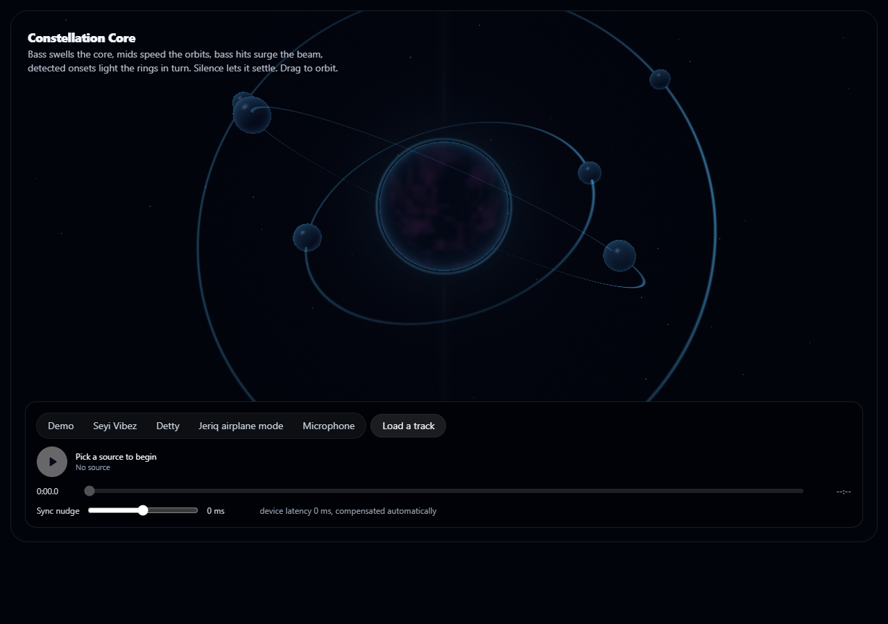
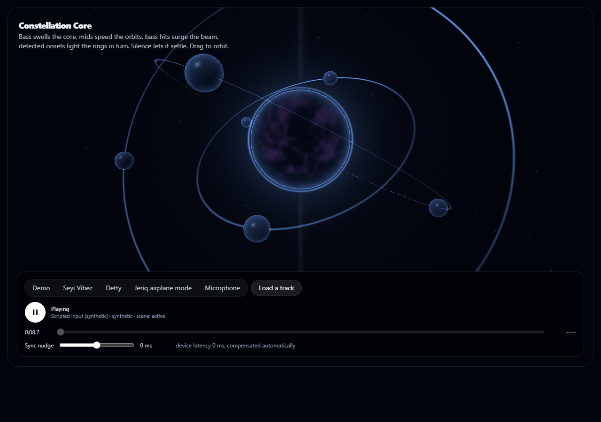
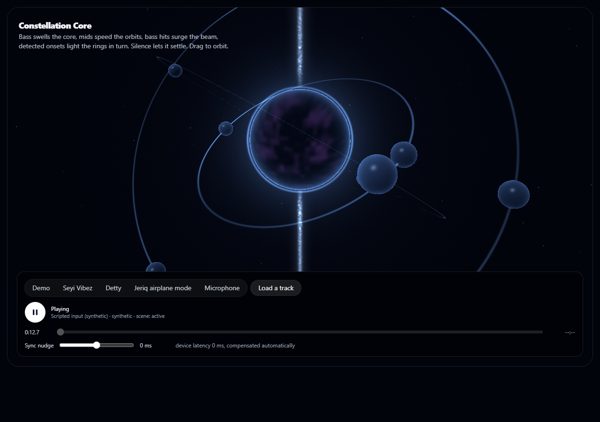

# Constellation Core: a planetary system that listens

A glowing core with orbiting moons, rings and a vertical beam, built with Three.js and custom shaders.
It reads the same audio features as the other visuals:

- **Bass** swells the core.
- **Mids** speed up the orbits.
- **Bass hits** surge the beam.
- **Detected onsets** light the rings in turn.
- **Silence** lets everything settle.

Drag to orbit the camera.

The code is in `web_kit/src/lib/constellation-core/` (parameters, scene, shaders, animator),
`web_kit/src/components/constellation-core/` (React wrapper) and `web_kit/src/components/gl/` (the shared WebGL host,
which handles resizing, hidden tabs and context loss).

## Screenshots

Captured from a real run on an Intel UHD GPU (headless Edge), driven by scripted synthetic audio.

| | |
|---|---|
|  | **Resting.** No audio: the core and rings are dim. |
|  | **Playing.** Sustained sound: the core glows and the orbits move. |
|  | **Bass hit.** The beam surges. |

## Verification

70 of 70 browser checks pass; 6 unit-test files cover parameters, scene and animation. At 1280x720 on integrated
graphics the median frame interval is 16.7 ms (60 fps) with 4.9 ms of GPU time. See
[docs/engineering](../../docs/engineering/README.md).
