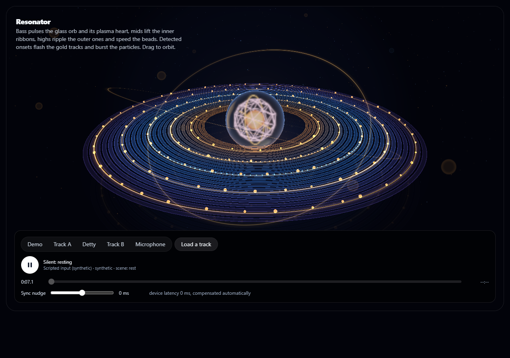
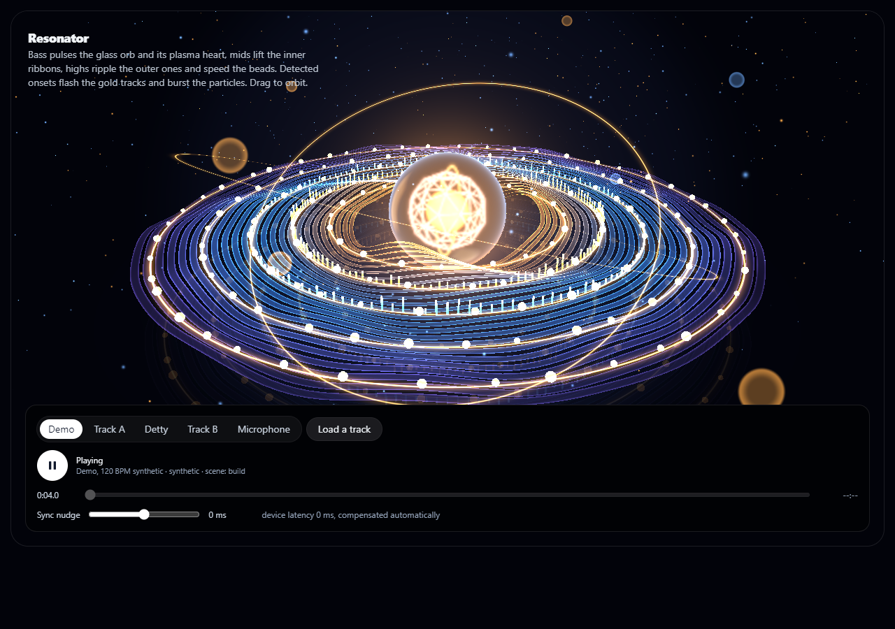
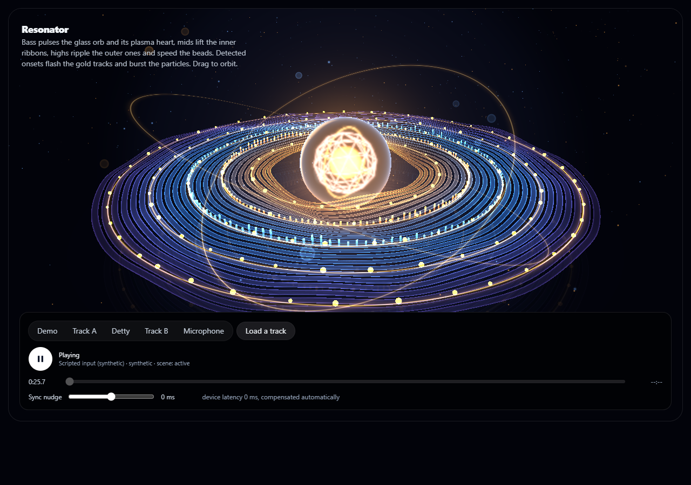
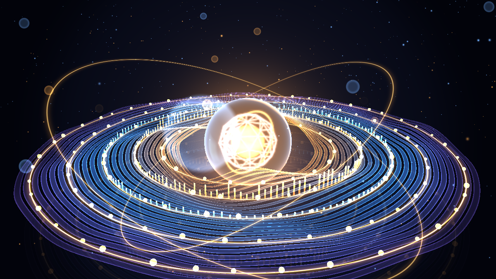

# Resonator: a glass orb inside waves of sound

A translucent glass orb with a glowing plasma heart sits at the centre of 24 fluid ribbon rings. Gold light tracks carry
orbiting node beads, two arcs of bars stand on the tracks, a dark glossy floor carries a mirrored copy of the light, and a
particle field hangs in the air. Built with Three.js and custom shaders on the shared audio pipeline.

The reference it follows is [reference.jpg](reference.jpg).

## What the music does

Only fields that exist on the audio frame contract (`web_kit/src/lib/pipeline/contract.ts`) are read.

| Audio signal | Visual |
|---|---|
| `bass` (20-150 Hz, sub included) | Glass orb scale pulse (up to about +7%), plasma core size and glow, warm point-light strength |
| `bassHit` (60-150 Hz punch) | A sharper, short kick on the orb |
| `mid` (150-2000 Hz, low-mids included) | Inner ribbon height, radial amplitude modulation, and the amber bars |
| `high` (2-10 kHz) | Outer ripple amplitude, frequency and travel speed; bead orbit and pulse speed; the cyan bars |
| `beatDetected` + `onsetStrength` | Flash on the gold tracks and beads, particle burst. It is a detected **onset**, not a beat-grid beat |
| `rmsEnergy` | Exposure, atmosphere (particles and haze), in-scene bloom strength and threshold |
| `currentSceneState` | Camera pushes in during build and active passages |
| silence, `prefers-reduced-motion` | Impulses (kick, flash, burst) are removed; motion slows; the levels still follow the music |

The contract has **no sub-bass or low-mid channel**; those bands are covered by `bass` and `mid`. It has three bands, not a
spectrum, so the bars follow their band's level times a fixed travelling pattern and do not show individual frequencies.
Flashes are limited to under 3 per second, as in the other scenes. Every response is smoothed with an attack and release;
waves and beads advance on accumulated phase, so a change in the music bends the motion rather than jumping it.

## Quality tiers and the bloom fallback

| Tier | Orb | Floor | Use |
|---|---|---|---|
| `full` (default) | `MeshPhysicalMaterial`, transmission 0.95, roughness 0.1, ior 1.5 | Mirrored copy of the light | Intel UHD at the app's normal canvas size |
| `lite` | Translucent shell, no transmission | Glow pool only, no mirror | Larger or higher-density canvases, or slower GPUs |

Choose the tier with the `quality` prop of `<Resonator>` (or `?quality=lite` in the preview harness). The tier is not switched
automatically. See [evidence/verification-2026-10-21.md](evidence/verification-2026-10-21.md) for the measured cost of each.

**Bloom:** a real bloom is a full-screen post-processing pass, and the shared `GlHost` draws straight to the canvas without one.
Adding it would change shared infrastructure and cost a lot on Intel UHD, so Resonator uses an in-scene stand-in: additive glow
on the tracks, bars and beads, a camera-facing halo over the heart, and a glass rim shell. Louder passages lower the halo's
threshold, so more of the scene glows.

## Code

- `web_kit/src/lib/resonator/`: `params.ts` (audio to parameters, pure), `animator.ts` (smoothing, phases, impulses), `scene.ts`, `shaders.ts`
- `web_kit/src/components/resonator/`: React wrapper (`Resonator.tsx`, `ResonatorCanvas.tsx`)
- `web_kit/src/app/lab/resonator/page.tsx`: the route
- `web_kit/tests/resonator-*.test.ts`: unit tests
- `web_kit/preview/resonator-entry.tsx`, `resonator.html`, `resonator-check.mjs`: preview harness and browser acceptance checks

## Preview

From `web_kit/`:

```
node preview/build.mjs resonator
node preview/serve-gl.mjs 5354
```

Open `http://localhost:5354/resonator`. Add `?source=demo` for the 120 BPM synthetic demo, `?source=song:detty` for the Detty
offline song, `?quality=lite` for the lite tier. Or pick a source with the on-page controls. Browser checks:
`node preview/resonator-check.mjs` (headless Edge on the real GPU; writes screenshots and a JSON report to `scratch_shots/resonator/`).

## Screenshots

Captured on an Intel UHD GPU (headless Edge).

| | |
|---|---|
|  | **Resting.** Scripted silence (synthetic): calm, ribbons nearly flat. |
|  | **Playing.** The 120 BPM synthetic demo. |
|  | **Bass hit.** Scripted synthetic input. |
|  | **Detty at 50 s.** Real analysed features of the Detty recording, on a silent clock (no audio is shipped). |
