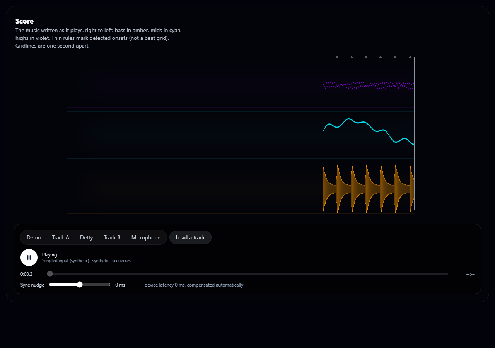
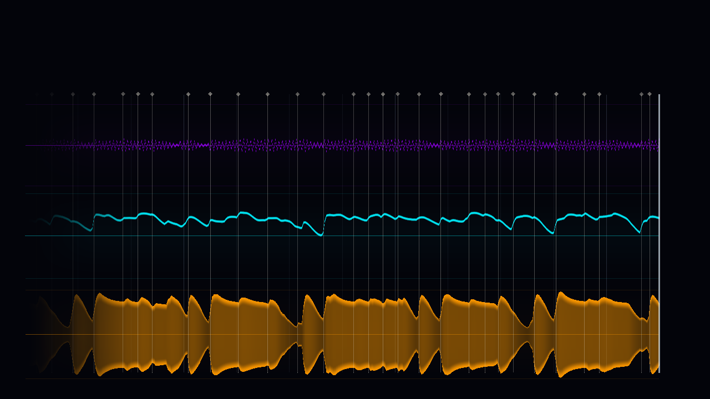
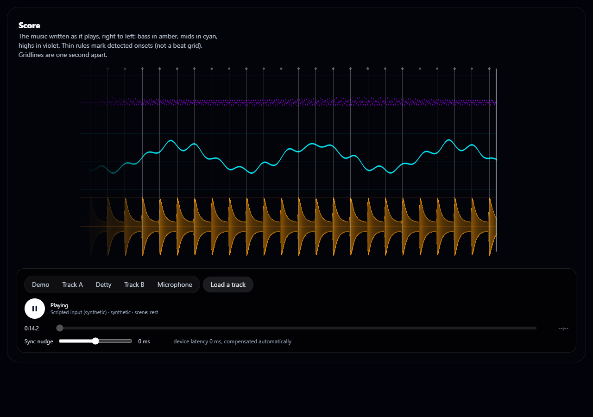
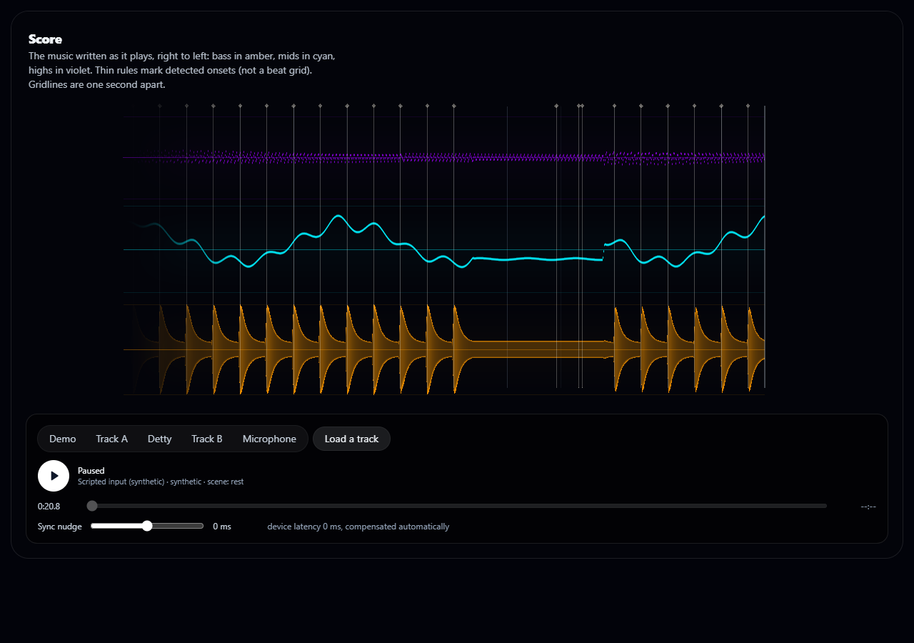

# Score: music written as it plays

A precision temporal instrument. Three horizontal lanes record the music and scroll from right to left; new history enters at the
current-time boundary on the right. Bass is a weighted amber envelope, mids a cyan trace that rises and undulates with level, highs a
fine violet trace. Thin rules mark detected **onsets** (not a beat grid) and travel with the history. Gridlines are one second apart.
There is no camera motion, no post-processing and no decorative particles: the identity is in the geometry.

The governing specification, identity, decisions and verification record are in
[docs/visual-systems/411-AUDIOLAB-VISUAL-SYSTEMS.md](../../docs/visual-systems/411-AUDIOLAB-VISUAL-SYSTEMS.md) (section 7).

## How history works

Frames carry no sequence number, so history is keyed to the playhead (`frame.time`): a sample is appended only when the playhead has
advanced 25 ms (longer than the 23.2 ms analysis hop), a repeated frame object is ignored, nothing is written while paused, a forward
jump over 0.5 s breaks the line, and a rewind or new source clears the record. Onsets are edge-detected on every frame. Storage is a
fixed ring (512 samples, 128 markers). This is a scene-local approximation of frame-locking; see the specification for the limitation.

## Code

`web_kit/src/lib/score/` (`history.ts`, `params.ts`, `animator.ts`, `scene.ts`, `shaders.ts`), `web_kit/src/components/score/`,
`web_kit/src/app/lab/score/page.tsx`, `web_kit/tests/score-*.test.ts`, `web_kit/preview/score-{entry.tsx,check.mjs}` and `score.html`.

## Preview

From `web_kit/`:

```
node preview/build.mjs score
node preview/serve-gl.mjs 5354
```

Open `http://localhost:5354/score`. Add `?source=pattern` for a scripted 120 BPM synthetic pattern, `?source=demo` for the synthetic demo,
`?source=song:detty` for the Detty offline song (real analysed features on a silent clock; no audio ships), `?decor=0` to remove the lane
plates. Or pick a source with the on-page controls. If port 5354 is busy, pass another port and set `SCORE_PORT` for the checks.
Browser checks: `node preview/score-check.mjs` (headless Edge, real GPU; screenshots and a JSON report go to `scratch_shots/score/`).

## Screenshots

Intel UHD GPU, headless Edge. Static frames: the scroll was verified numerically, not captured as motion.

| | |
|---|---|
|  | **Scripted 120 BPM pattern (synthetic).** One marker per kick, each on its amber attack. |
|  | **Detty at 53 s (real features, silent clock).** |
|  | **Decor off.** The lanes, markers and grid alone. |
|  | **Paused.** History frozen exactly. |
