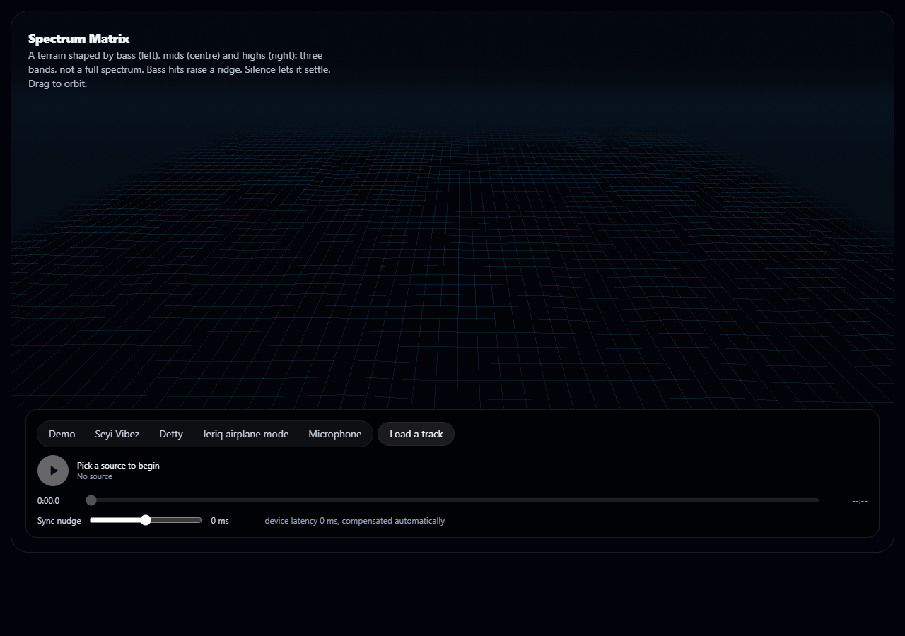
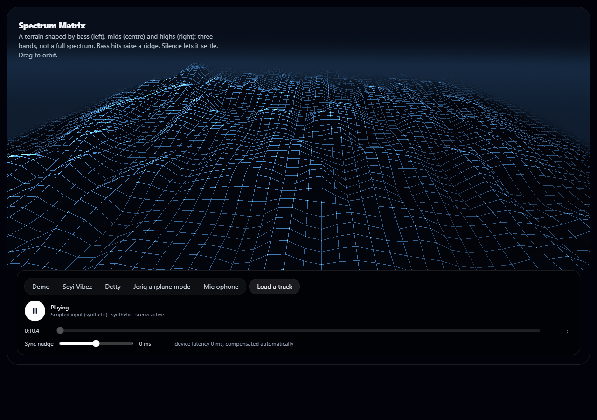
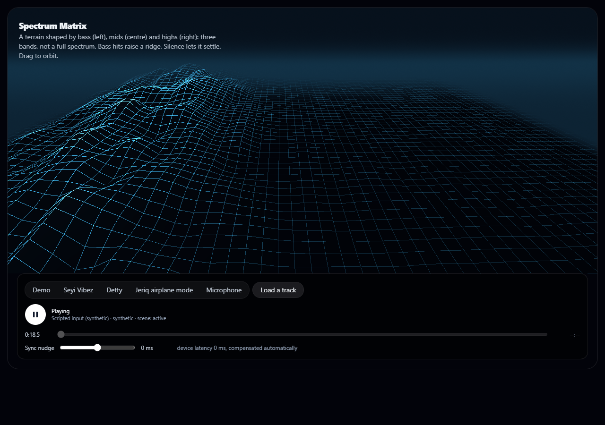

# Spectrum Matrix: a terrain shaped by the music

A wireframe landscape built with Three.js and custom shaders. The terrain is shaped by three audio bands:
bass on the left, mids in the centre and highs on the right. These are three bands, not a full spectrum.
A bass hit raises a ridge that travels across the terrain, and silence lets the surface settle. Drag to orbit.

The code is in `web_kit/src/lib/spectrum-matrix/` (parameters, scene, shaders, animator),
`web_kit/src/components/spectrum-matrix/` (React wrapper) and `web_kit/src/components/gl/` (the shared WebGL host).

## Screenshots

Captured from a real run on an Intel UHD GPU (headless Edge), driven by scripted synthetic audio.

| | |
|---|---|
|  | **Resting.** No audio: a calm, flat grid. |
|  | **Playing.** Sustained sound across all three bands. |
|  | **Bass band.** Input concentrated in the bass band. |

## Verification

60 of 60 browser checks pass; 6 unit-test files cover parameters, scene and animation. At 1280x720 on integrated
graphics the median frame interval is 16.7 ms (60 fps) with 4.4 ms of GPU time. See
[docs/engineering](../../docs/engineering/README.md).
